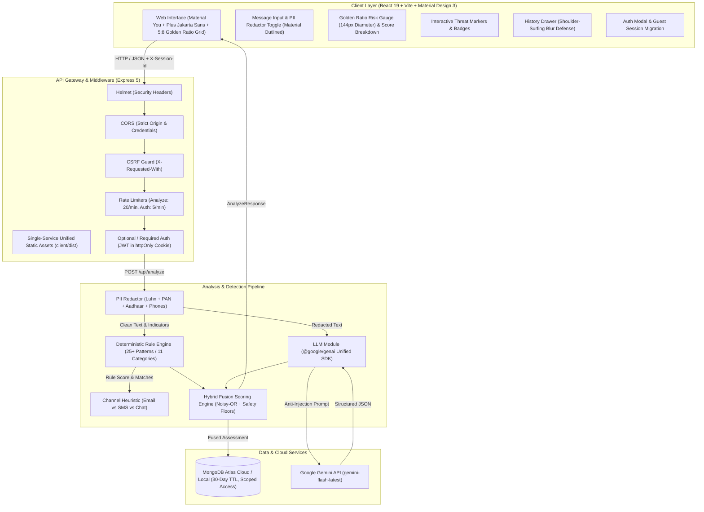
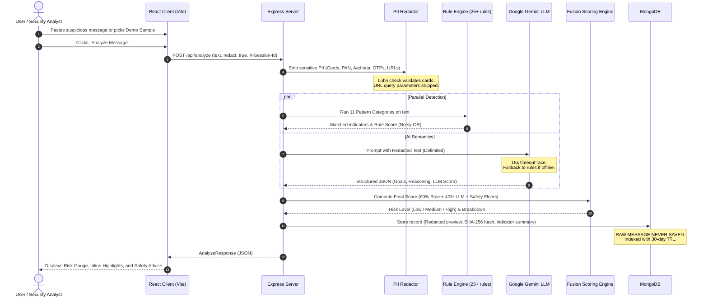

# PhishGuard AI: Architecture & Security Specification

PhishGuard AI is an enterprise-grade phishing and social engineering awareness web application designed to evaluate suspicious messages, detect deceptive tactics, explain threats via an LLM, and provide immediate, actionable safety recommendations.

---

## 1. System Architecture Diagram



---

## 2. End-to-End Analysis Sequence



---

## 3. Privacy Architecture: Zero Raw Storage Guarantee

One of the foundational principles of PhishGuard AI is that user privacy is never compromised to achieve security evaluation:

1. **Client & Server-Side Redaction:**
   - **Payment Cards:** Detected via regex and verified using the **Luhn Algorithm** (rejecting false positives).
   - **Indian National Identifiers:** Indian PAN card regex (`[A-Z]{5}[0-9]{4}[A-Z]`) and Aadhaar 12-digit format (`\b\d{4}\s\d{4}\s\d{4}\b`).
   - **Phone Numbers:** International E.164 and Indian 10-digit formats (`+91`, `0`, or bare `9/8/7/6`).
   - **One-Time Passwords (OTPs):** 4 to 8 digit numerical tokens matching verification phrases.
   - **URL Query Parameters:** Tracking parameters (`token`, `auth`, `session`, `key`) stripped to prevent token exposure.
2. **Zero Raw Text in Database:**
   - The database document schema contains only:
     - `contentHash`: SHA-256 digest of the original text for duplicate/recurrence tracking.
     - `redactedPreview`: The first 160 characters of the *redacted* text, terminated with `...`.
     - `indicatorSummary`: Counts and severities of detected categories.
     - `explanationSummary`: High-level summary synthesized by the model.
   - The raw message text is discarded immediately after request processing.
3. **Data Retention & Expiration:**
   - MongoDB documents are created with a native TTL index on `createdAt`:
     ```typescript
     AnalysisRecordSchema.index({ createdAt: 1 }, { expireAfterSeconds: 30 * 24 * 60 * 60 });
     ```
   - Records automatically self-purge after 30 days.

---

## 4. Hybrid Detection & Scoring Engine

PhishGuard AI does not rely solely on LLMs (which are vulnerable to hallucinations and latency) nor solely on regex (which misses novel semantic phrasing). It fuses both into an explainable mathematical pipeline.

### Deterministic Rule Engine
The engine evaluates 25+ regular expression and heuristic patterns across 11 distinct categories:
- **`urgency` (weight: 0.65):** Artificial time constraints ("immediate action required", "within 24 hours").
- **`credential_request` (weight: 0.85):** Solicitations for passwords, PINs, OTPs, or master keys.
- **`financial_lure` (weight: 0.60):** Fake lottery wins, crypto giveaways, refund notifications.
- **`authority_impersonation` (weight: 0.70):** Spoofing executives, IT departments, tax authorities, or banks.
- **`threat_or_fear` (weight: 0.70):** Coercion regarding account suspension, legal action, or police reports.
- **`generic_greeting` (weight: 0.30):** Absence of personal identification ("Dear Customer", "Undisclosed recipient").
- **`attachment_lure` (weight: 0.65):** Prompts to open `.exe`, `.scr`, `.iso`, `.zip`, `.vbs`, or macros.
- **`link_risk` (weight: 0.75):** Punycode spoofing, IP-based URLs, URL shorteners (bit.ly, t.co), non-TLS `http://`, and anchor text / href mismatches.
- **`sender_spoofing` (weight: 0.65):** Free webmail used for corporate claims, display name spoofing.
- **`smishing_india` (weight: 0.80):** High-prevalence Indian vectors: electricity disconnection notices, e-Challan SMS traps, APK download links, and UPI collect requests.
- **`emotional_manipulation` (weight: 0.55):** Guilt-tripping, fake charity pleas, blackmail / sextortion scripts.

### Noisy-OR Rule Score Aggregation
Multiple weak indicators compound non-linearly using the probabilistic Noisy-OR formulation:

$$\text{RuleScore} = 100 \times \left(1 - \prod_{i=1}^{n} (1 - w_i)\right)$$

Where $w_i \in (0, 1)$ represents the individual indicator weight. If even two high-severity indicators ($0.85$ and $0.80$) are present, the rule score compounds to $97/100$.

### Safety Floor Overrides
To ensure mission-critical risks are never diluted by an agreeable LLM score, two safety floors are enforced:
1. **Credential Theft Floor (70):** If a `credential_request` occurs alongside `urgency` or `link_risk`, final score $\ge 70$ (guaranteed **HIGH** risk).
2. **Malicious Attachment Floor (60):** If an executable or script attachment lure is detected, final score $\ge 60$ (guaranteed **MEDIUM/HIGH** risk).

### LLM & Rule Fusion
When Gemini is available:

$$\text{FinalScore} = \text{round}(0.60 \times \text{RuleScore} + 0.40 \times \text{LLMScore})$$

If the safety floor exceeds this calculation, the floor value is applied and documented in the response `floorApplied` metadata. If Gemini is unavailable (network partition, timeout, or rate-limited API key), the system seamlessly degrades to $\text{FinalScore} = \text{RuleScore}$ with `aiAvailable: false`.

---

## 5. Security & Threat Mitigation Matrix

| Potential Vulnerability / Attack Vector | Defense Implemented in PhishGuard AI |
| :--- | :--- |
| **Prompt Injection via Analyzed Email** | Redacted input is wrapped in strict XML boundary tags (`<untrusted_content>`). System instructions explicitly order the LLM to analyze the text as passive data and never execute user instructions within the content. |
| **Cross-Site Request Forgery (CSRF)** | `requireCsrfHeader` rejects all non-safe HTTP methods (`POST`, `PUT`, `DELETE`) unless the client sends `X-Requested-With: XMLHttpRequest`. Standard HTML form action tags cannot attach this custom header cross-origin. |
| **Brute Force & Credential Stuffing** | `authRateLimiter` restricts authentication endpoints to 5 attempts per minute per IP address. `analyzeRateLimiter` limits analyses to 20 per minute per IP. |
| **Timing Attack / User Enumeration** | During `/api/auth/login`, if an email does not exist, a constant-time dummy verification (`verifyPassword('dummy_password_timing_pad', '$argon2id...')`) is executed before returning a generic `401 Invalid credentials.` response. |
| **Token Theft / XSS Cookie Sniffing** | JWT Access and Refresh tokens are delivered via `httpOnly`, `sameSite: 'lax'`, `path: '/'` cookies. Client-side JavaScript cannot access token secrets. |
| **Cross-Session Data Leakage** | History queries are strictly scoped: guest users can only query records matching their random cryptographic `X-Session-Id`; authenticated users can only query records matching their MongoDB `userId`. |
| **Right to Be Forgotten (GDPR / DPDP)** | `DELETE /api/auth/me` executes an atomic cascade: all analysis records associated with `userId` and the user profile are permanently deleted in MongoDB. |
